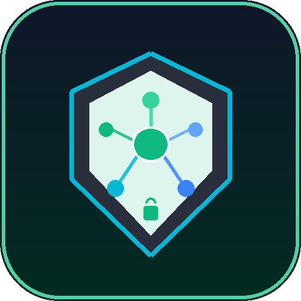

# SNV AI — Your Private AI. Running Locally.

<p align="center">
  
</p>

<p align="center">
  <strong>A Real Windows Desktop Application for 100% Offline AI Assistance</strong><br>
  No Cloud APIs • Zero Remote Data Transfer • Complete Privacy
</p>

---

## 🌟 Overview

**SNV AI** is a native Windows desktop application designed to provide the fluid conversational experience of modern AI assistants like ChatGPT and Gemini, with one fundamental difference:

> **Everything runs 100% locally on your own computer.**
> No internet connection is required for normal conversations, document analysis, or coding help.

- **Real Desktop Application**: Opens directly in its own standalone window with native controls (minimize, maximize, close), application icon, Desktop shortcut, and Start Menu shortcut.
- **Offline Inference**: Powered by local LLM engines (Ollama) with streaming responses, stop generation, regeneration, and message editing.
- **Document Mode (Local RAG)**: Attach PDFs, Word documents, text files, CSVs, JSON, or source code. Text is extracted, chunked, and queried locally using built-in BM25 retrieval without external services.
- **Specialized Modes**:
  - 🎓 **Study Mode**: Automatically structures concepts into **WHAT → WHY → HOW → EXAMPLE**.
  - 💻 **Coding Mode**: Explains code logic, edge cases, algorithms, and provides syntax-highlighted code with one-click **Copy Code**.
  - 📄 **Document Mode**: Prioritizes and grounds responses strictly in attached local documents.
  - ⚡ **General Assistant**: General problem solving, brainstorming, and writing.
- **Image / Vision Support**: Connects to local vision models (such as `llava` or `llama3.2-vision`) to inspect images offline.
- **Local SQLite Database**: Every conversation, message, and setting is saved locally in an ACID-compliant SQLite database in Windows `%APPDATA%\snv-ai\data\snv_ai.db`.
- **Strict Offline Mode**: Toggleable mode that guarantees zero outbound network traffic.

---

## 🚀 Quick Start Guide

### 1. Install SNV AI
Double-click:
```
SNV-AI-Setup.exe
```
Follow the installation wizard:
- The installer installs SNV AI to `AppData\Local\Programs\SNV AI`.
- Creates a **Desktop Shortcut** (`SNV AI`).
- Creates a **Start Menu Shortcut** (`SNV AI`).

Once installed, double-click the **SNV AI** icon on your Desktop. The application opens directly in its own window.

### 2. Set Up Local AI Model (Ollama)
SNV AI connects to Ollama running locally at `http://127.0.0.1:11434`.

1. **Install Ollama** (one-time setup):
   - Download Ollama from [https://ollama.com](https://ollama.com) or run `winget install Ollama.Ollama`.
2. **Download your preferred local model** (one-time command in PowerShell/Terminal):
   - For fast, balanced everyday chat:
     ```powershell
     ollama run llama3.2
     ```
   - For coding and multilingual mastery:
     ```powershell
     ollama run qwen2.5
     ```
   - For image and vision understanding:
     ```powershell
     ollama run llava
     ```
3. Open **SNV AI**. The app will detect the local engine and show **● Local AI Ready**.

---

## 🔒 100% Offline Test Procedure

To verify that SNV AI works with **zero internet**:

1. **Disconnect your computer from Wi-Fi and Ethernet** (or turn on Airplane Mode).
2. Close your terminal, VS Code, and browser.
3. Double-click the **SNV AI** desktop icon.
4. Type a prompt:
   ```
   Explain polymorphism in Java.
   ```
5. Observe the local AI generate the streaming response with syntax-highlighted code.
6. Attach a local document (e.g., `DBMS.pdf` or `notes.txt`) and ask:
   ```
   Explain the main concepts in this file.
   ```
7. Verify that SNV AI analyzes the file and answers completely offline.

---

## 🛠️ Architecture & Security

```
User
  │
  ▼
[ SNV AI Desktop Application ] (Electron + React + TypeScript)
  ├── Frameless Windows Titlebar (Minimize / Maximize / Close)
  ├── Secure Context-Isolated Preload Bridge
  ├── React Renderer (Tailwind CSS, Markdown Parser, Highlight.js)
  └── Electron Main Process (Node.js)
        ├── Ollama Local API Client (NDJSON streaming, AbortController)
        ├── SQLite Local Database (sql.js Wasm stored in %APPDATA%/snv-ai/)
        ├── Local Document Parser (pdf-parse, mammoth, UTF-8 code reader)
        ├── Local RAG Engine (Sliding-window chunking + BM25 relevance)
        └── Windows Integration (Desktop shortcuts, startup settings)
```

### Security & Privacy Protections
- **Context Isolation Enabled**: Renderer processes have no direct access to Node.js or OS primitives.
- **Zero Remote Telemetry**: SNV AI does not collect analytics or make external tracking calls.
- **Sanitized Markdown**: Rendered markdown blocks sanitize raw script execution.
- **No Arbitrary Code Execution**: AI-generated code is only displayed with syntax highlighting and a copy button—never auto-executed.

---

## 📂 Project Structure

```
offline_gpt/
├── assets/
│   ├── icon.svg            # High-res vector logo
│   ├── icon.png            # 512x512 application icon
│   ├── icon.ico            # Multi-res Windows application icon
│   └── generate_icons.py   # Icon generation utility
├── electron/
│   ├── main.ts             # Electron main process & IPC handlers
│   ├── preload.ts          # Secure contextBridge API
│   ├── types.ts            # Shared TypeScript data models
│   └── services/
│       ├── ollamaService.ts   # Local Ollama stream & health client
│       ├── dbService.ts       # SQLite database engine
│       ├── documentParser.ts  # PDF, Word, TXT, Code parser
│       └── ragService.ts      # Local text chunking & BM25 retrieval
├── src/
│   ├── App.tsx             # Root React application
│   ├── main.tsx            # Vite entry point
│   ├── vite-env.d.ts       # TypeScript window.snvAi declarations
│   ├── types/              # Renderer types
│   ├── styles/             # Tailwind & Markdown CSS
│   └── components/
│       ├── Common/TitleBar.tsx          # Custom Windows window controls
│       ├── Sidebar/Sidebar.tsx          # Chat history, search, model pill
│       ├── Chat/ChatArea.tsx            # Chat workspace container
│       ├── Chat/WelcomeScreen.tsx       # First-run diagnostic checklist
│       ├── Chat/MessageList.tsx         # Message rendering & auto-scroll
│       ├── Chat/MessageItem.tsx         # Markdown bubble, copy, edit, regenerate
│       ├── Chat/CodeBlock.tsx           # Syntax highlighting & copy button
│       ├── Chat/ChatInput.tsx           # Input textarea, mode switcher, attachments
│       ├── Models/ModelSelectorModal.tsx# Local models list & install guide
│       └── Settings/SettingsModal.tsx   # Settings, storage stats, clear history
├── dist/                   # Compiled Vite web assets
├── dist-electron/          # Compiled Electron main scripts
├── dist-package/           # Packaged Windows binaries & installer
│   ├── SNV-AI-Setup.exe    # Official Windows Installer (NSIS)
│   └── win-unpacked/       # Standalone portable directory
├── SNV-AI-Setup.exe        # Root copy of the Windows installer
├── electron-builder.json5  # Windows packaging configuration
├── package.json
└── tsconfig.json
```

---

## 📜 Development Scripts

If you want to modify or rebuild the application:

```powershell
# Run dev environment
npm run dev

# Compile React bundle
npm run build:react

# Compile Electron scripts
npm run build:electron

# Build both React and Electron
npm run build

# Package Windows NSIS Installer (SNV-AI-Setup.exe)
npx electron-builder --win --config electron-builder.json5
```

---

## ⚖️ License
MIT License. Built for private, offline local artificial intelligence.
